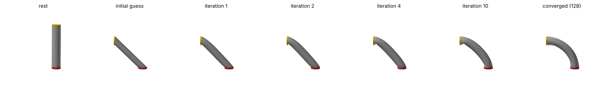
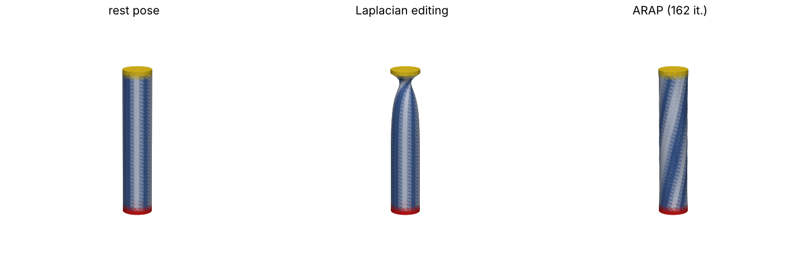
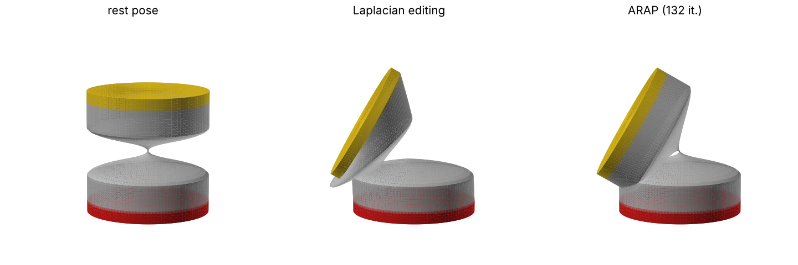
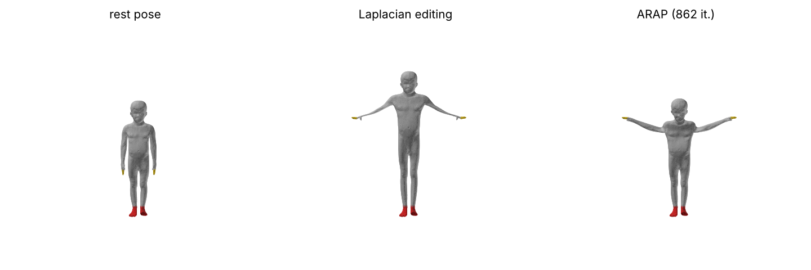
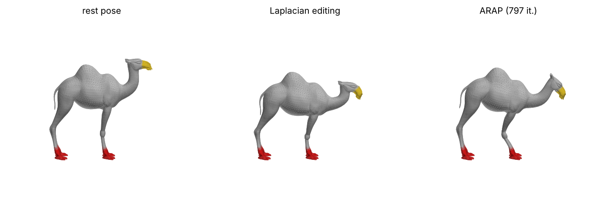
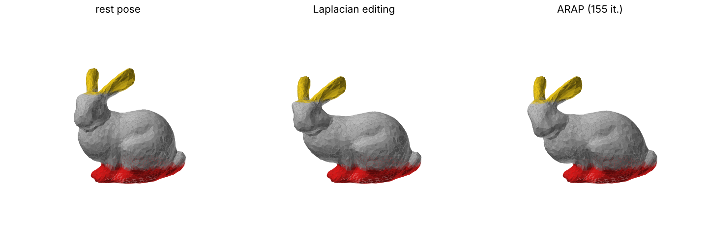
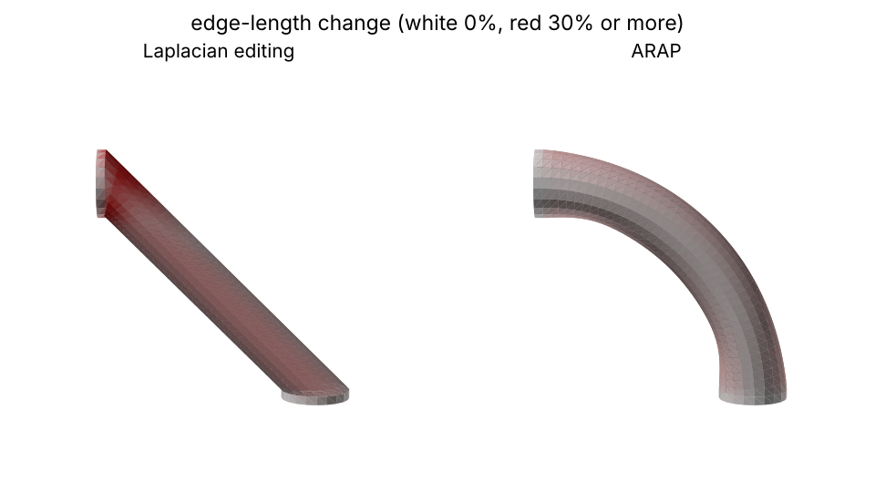
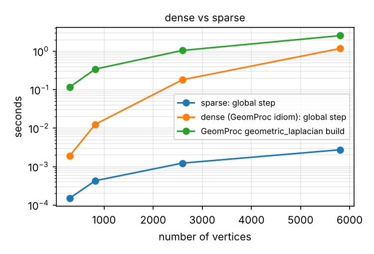
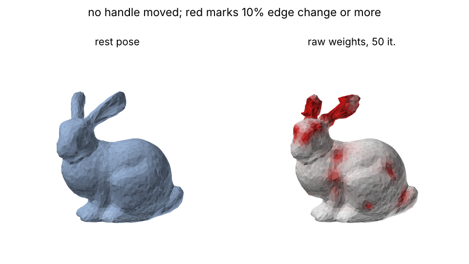
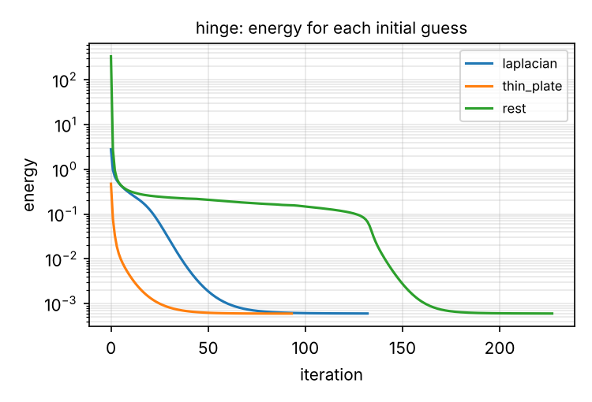

# As-rigid-as-possible surface deformation

COMP 4900D project 2.11: an implementation of "As-Rigid-As-Possible Surface
Modeling" (Sorkine and Alexa, SGP 2007) built on the course's GeomProc
library.



## Setup

Python 3.10 or newer.

```bash
python -m venv .venv
source .venv/bin/activate
pip install -r requirements.txt        # numpy, scipy, matplotlib
pip install -r requirements-dev.txt    # adds pytest, and libigl for the comparisons in the tests and experiments
```

GeomProc is not on PyPI, so version 1.9 (commit `894415c` of
<https://github.com/ovankaic/GeomProc>) is included unchanged in `geomproc/`
together with its licence. Its sample meshes are in `meshes/`. Run every
command from the repository root.

## Usage

```python
import numpy as np
from arap.meshio import load_mesh, save_mesh
from arap import selection as sel
from arap.solver import ARAPDeformer

V, F = load_mesh("meshes/bunny.obj")                  # GeomProc load + normalize
fixed = sel.by_coordinate(V, "y", below=0.15)          # base stays put
ears = sel.by_coordinate(V, "y", above=0.8)            # handle
constrained, targets = sel.combine(V, fixed, ears, V[ears] + [-0.45, -0.15, 0.0])

deformer = ARAPDeformer(V, F, constrained)             # factorises L once
result = deformer.deform(targets)                      # Laplacian guess, then iterate
print(result.iterations, result.converged, result.energies[-1])
save_mesh("output/bunny_arap.obj", result.vertices, F)
```

`ARAPDeformer` can be reused for any number of target positions as long as the
set of constrained vertices stays the same. Options:

| argument | values | default |
|---|---|---|
| `weights` | `"cotangent"`, `"uniform"` | `"cotangent"` |
| `clamp` (negative cotangent weights) | `"zero"`, `"none"` (paper), `"geomproc"` | `"zero"` |
| `init` in `deform` | `"laplacian"` (slides), `"thin_plate"`, `"rest"`, or an (n, 3) array | `"laplacian"` |
| `max_iterations`, `energy_tol`, `step_tol` | stopping rule, see below | 1000 in the experiments, 500 otherwise |

Experiments and tests:

```bash
python -m experiments.run_all                      # all experiments, writes output/
python -m experiments.run_all --only bar_bend hinge
python -m experiments.run_all --update-docs        # also refreshes docs/figures and docs/results.md
python -m pytest
```

`output/` receives, for every scenario, the rest pose, the Laplacian editing
result and the ARAP result as OBJ files with the constrained vertices coloured
(fixed red, handles yellow) for viewing in MeshLab, plus the figures, the
energy curve, `metrics.json` and `summary.md`. A full run takes about five
minutes.

## Code layout

| module | contents |
|---|---|
| `arap/laplacian.py` | sparse cotangent and uniform weights, `L = D - W`, mixed (Voronoi) areas |
| `arap/rotations.py` | batched best-fit rotations with the reflection fix |
| `arap/linear.py` | constrained sparse solver (factorised once), membrane and thin-plate deformation from the slides |
| `arap/solver.py` | `ARAPDeformer`: local step, global step, energy, gradient, iteration |
| `arap/reference.py` | dense solves with GeomProc's own `geometric_laplacian`, the way the class demos solve systems |
| `arap/selection.py` | choosing fixed and handle vertices, rigid targets (uses GeomProc's rotation helpers) |
| `arap/metrics.py` | edge-length distortion |
| `arap/meshio.py` | loading, normalising and saving through GeomProc |
| `arap/viz.py` | off-screen figures with matplotlib |
| `experiments/` | the scenarios and `run_all.py` |
| `tests/` | unit tests, GeomProc consistency checks, comparison with libigl |

## Method

With rest positions `p`, deformed positions `p'`, edge weights `w_ij` and one
rotation `R_i` per vertex, ARAP minimises (paper Eq. 7, with `w_i = 1`)

```
E(p', R) = sum_i sum_{j in N(i)} w_ij || (p'_i - p'_j) - R_i (p_i - p_j) ||^2
```

by alternating two steps, each of which can only lower the energy:

1. **Local step** (Section 2.1). With `p'` fixed, `R_i` is the rotation that
   best maps the rest edges around vertex `i` onto the deformed ones. With
   `S_i = sum_j w_ij e_ij e'_ij^T = U Σ V^T`, `R_i = V U^T`. If that has
   determinant -1, the column of `U` for the smallest singular value is
   negated. All vertices are done in one batched `numpy.linalg.svd` call.
2. **Global step** (Eq. 8 and 9). With the rotations fixed, `p'` solves
   `L p' = b`, where `L = D - W` and
   `b_i = sum_j (w_ij / 2) (R_i + R_j) (p_i - p_j)`.
   Constrained vertices are eliminated (Eq. 10): their columns move to the
   right-hand side and the remaining block stays symmetric positive definite.
   That block depends only on the rest mesh and the constrained set, so it is
   factored once with `scipy.sparse.linalg.splu`. Each iteration then costs
   one batched SVD and three back-substitutions.

**Initial guess.** The course slides (Topic 7) define Laplacian deformation as
solving `Δd = 0` for the displacements `d` of the free vertices, with the
handles and fixed vertices prescribed. With the cotangent operator
`Δ = -M^{-1} L` the per-vertex area factor cancels, so this is `L p' = L p`:
naive Laplacian editing, which is also the global step with every `R_i = I`.
This is the default initial guess, the same one used in the paper's Fig. 3.
The thin-plate version from the slides, `Δ²d = 0` (solved as
`L M^{-1} L d = 0`), is available as an alternative.

**Stopping rule.** Iterate until the energy decrease of an iteration is below
`1e-6` times the energy of the initial guess and no vertex moved more than
`1e-5` of the bounding-box diagonal, or the iteration limit is reached. The
decrease is compared with the initial energy, not the current one: when the
constraints allow a rigid motion the minimum energy is zero, and a decrease
relative to the current energy then never becomes small.

## Design decisions

**Sparse operator instead of GeomProc's dense one.** GeomProc's
`mesh.geometric_laplacian` builds a dense `n × n` matrix in Python loops, and
the class demos solve with `numpy.linalg.solve` on every call. That is fine for
the bunny but too slow to run hundreds of iterations on the 8 000 to 10 000
vertex meshes (see the timing table). The operator here is built with numpy and
`scipy.sparse`, which the handout allows for linear algebra. With
`clamp="geomproc"` it reproduces GeomProc's operator to rounding error, and
`tests/test_reference.py` checks that the sparse solver and a dense solve on
GeomProc's own matrix give the same deformation.

**A consistent Laplacian.** GeomProc's operator is row-normalised:
`L_gp = D^{-1} W - I`. The handout warns that the Laplacian must be used
consistently. Scaling a row of `L` changes the solution unless the same row of
`b` is scaled by the same factor. With `L_gp` the right-hand side must be
`b_i = sum_j L_gp[i, j] · 1/2 (R_i + R_j)(p_j - p_i)`, and likewise for an
area-weighted operator `M^{-1}(W - D)`. After a single step, pairing `L_gp`
with the paper's unscaled `b` moves vertices by 34 % (bar) to 68 % (bunny) of
the bounding-box diagonal, and pairing the area-weighted operator with it
moves them by 11 % to 24 % (consistency table below; the area-weighted error
also depends on the mesh's scale, since `M^{-1}` scales as one over length
squared). The code uses the unscaled symmetric `L` with the unscaled `b`, and
the tests and the experiments check that both scaled variants give the same
answer when their `b` is scaled to match.

**Negative cotangent weights are clamped to zero.** This is the one deviation
from the paper. The scanned meshes have many obtuse triangles (12 % of the
camel's edges have a negative weight). With negative weights the energy can
become negative and the rest pose is no longer a minimum, so the iterations
walk away from it even when no handle has moved: after 50 iterations the
camel has drifted by 15 % of its diagonal (table below). Clamping makes the energy non-negative and the rest
pose an exact fixed point. GeomProc's operator is also non-negative, because
its mixed-area treatment replaces a negative cotangent by half the triangle
area. The raw weights are still available with `clamp="none"`, which is what
libigl uses, and the tests compare that setting against libigl.

**Elimination instead of row replacement.** The class demos impose
constraints by replacing rows of the matrix with identity rows. That gives the
same solution, but the matrix stops being symmetric. Elimination keeps the
system symmetric positive definite.

## Results

All numbers come from one run of `python -m experiments.run_all` (under six
minutes) on a shared 4-core 2.1 GHz Xeon virtual machine with Python 3.13,
NumPy 2.5 and SciPy 1.18. On that machine timings vary by up to about 40 %
between runs; every other number is the same from run to run.
The full tables are in [docs/results.md](docs/results.md). Edge error is the
RMS of the relative edge-length change `(|e'| - |e|) / |e|` over all edges;
distances are divided by the bounding-box diagonal. The loaded meshes are
normalised with GeomProc so their longest side spans [-1, 1]; the synthetic
bar (GeomProc's `create_cylinder`) has radius 0.1 and length 1. Timings are
medians of repeated runs, and "ms per iteration" includes the energy and the
convergence test.

### Deformations

| scenario | vertices | constrained | iterations | within 1 % of final energy after | edge error, Laplacian editing | edge error, ARAP | ms per iteration |
|---|---|---|---|---|---|---|---|
| bar bend, 90° | 822 | 82 | 128 | 31 | 0.191 | 0.065 | 3.2 |
| bar twist, 135° | 822 | 82 | 162 | 70 | 0.175 | 0.076 | 3.8 |
| two-part cylinder hinge, 60° | 6 002 | 1 202 | 132 | 108 | 0.669 | 0.011 | 23 |
| bunny ears | 2 503 | 881 | 155 | 22 | 0.068 | 0.036 | 10 |
| kid raising its arms | 8 441 | 724 | 862 | 90 | 0.201 | 0.041 | 38 |
| camel lowering its head | 9 770 | 3 381 | 797 | 96 | 0.100 | 0.017 | 45 |

Fixed vertices are red and handles yellow (the twisted bar's other vertices
are striped so the twist shows). Each row shows the rest pose, Laplacian
editing (the initial guess) and the converged ARAP result.







- **Laplacian editing does not rotate local detail.** It only interpolates
  the handle displacements. The bent bar shears into a slanted tube, the
  twisted bar collapses towards its axis near the handle, the kid's arms
  stretch into thin strands, and the camel's body sinks while its legs bend.
  ARAP lowers the edge error by a factor of about 2 (bunny) to 60 (hinge).
- **Rigid parts stay rigid.** In the hinge, the top block should turn as a
  rigid body around the thin neck. Inside the block, leaving out the handle
  itself, the edge error is 0.33 for Laplacian editing and 0.0002 for ARAP.
- **Some stretch is unavoidable.** A bar of radius 0.1 bent into a quarter
  circle of radius 2/π ≈ 0.64 has to stretch by about 16 % on the outside of
  the bend and compress by as much on the inside, so no deformation that
  meets these constraints can have zero edge error.



**Convergence.** The energy decreased at every iteration in every run, as the
two exact steps guarantee. Most of the change happens early: the energy is
within 1 % of its final value after 22 to 108 iterations. The stopping rule
then keeps iterating while vertices still creep by more than `1e-5` of the
diagonal, which takes up to about 860 iterations on the larger meshes with
little visible change.

### Timing

| vertices | setup (weights + factorisation) | local step | global step (sparse) | global step (dense, GeomProc operator) | building GeomProc's operator |
|---|---|---|---|---|---|
| 822 | 4 ms | 2.8 ms | 0.4 ms | 13 ms | 0.34 s |
| 2 594 | 9 ms | 8.1 ms | 1.2 ms | 181 ms | 1.1 s |
| 5 810 | 19 ms | 18 ms | 2.7 ms | 1 180 ms | 2.5 s |
| 23 138 | 101 ms | 74 ms | 13 ms | not run | not run |



Times are for the bar bend on cylinders of increasing resolution. Each
iteration is dominated by the local step (the covariances and the batched
SVD). Because the factorisation is reused, the global step is about six
times cheaper than the local step, and about 400 times cheaper than a dense
`numpy.linalg.solve` on GeomProc's matrix at 5 810 vertices. A full ARAP run
on the 10 000-vertex camel takes about 36 seconds, most of it in the final
creeping iterations.

### Negative cotangent weights

| mesh | edges with a negative raw weight | drift after 50 iterations, raw weights | same with libigl | drift, clamped at zero |
|---|---|---|---|---|
| bunny | 7.2 % | 0.072 | 0.072 | 4e-14 |
| camel | 11.9 % | 0.148 | 0.148 | 1e-13 |
| kid | 5.2 % | 0.028 | 0.028 | 1e-13 |

No handle is moved in this test, so the rest pose is the correct answer. With
raw weights the energy becomes negative and the surface drifts away from it.
libigl, which uses raw weights, drifts by the same amount.



### Edge weights

| scenario | weights | edge error (RMS) | edge error (max) | iterations |
|---|---|---|---|---|
| bunny ears | cotangent | 0.036 | 0.25 | 155 |
| bunny ears | uniform | 0.037 | 0.31 | 123 |
| camel | cotangent | 0.017 | 0.20 | 797 |
| camel | uniform | 0.014 | 0.22 | 1 000 (limit) |

The two weightings give similar edge errors on these meshes. Cotangent weights
have the smaller worst-case error and converge on the camel, where uniform
weights hit the iteration limit. The paper's argument for cotangent weights is
that they make the result depend less on how the surface is triangulated,
which edge error alone does not measure.

### Initial guess

| scenario | Laplacian editing (slides) | thin plate (slides) | rest pose |
|---|---|---|---|
| bar bend | 128 iterations | 118 | 142 |
| hinge | 132 | 93 | 227 |
| camel | 797 | 781 | 798 |



All three starting points reach the same pose to within 0.1 % of the
diagonal. The thin-plate guess starts at a lower energy and saves iterations
on the bar and the hinge. Starting from the rest pose costs the most
iterations.

### Agreement with GeomProc and libigl

Largest distance between corresponding vertices, divided by the bounding-box
diagonal.

| | bar bend | bunny ears |
|---|---|---|
| membrane solve, GeomProc operator | 7e-15 | 1e-15 |
| one ARAP step, GeomProc operator, consistent `b` | 7e-15 | 2e-15 |
| ten ARAP iterations, GeomProc operator | 2e-14 | 6e-15 |
| one step, GeomProc operator, inconsistent `b` | **0.34** | **0.68** |
| one step, area-weighted operator, consistent `b` | 2e-12 | 5e-13 |
| one step, area-weighted operator, inconsistent `b` | **0.11** | **0.24** |
| libigl, ten iterations, raw weights | 9e-6 | 6e-5 |

The GeomProc rows compare the sparse solver (with `clamp="geomproc"`)
against dense solves on GeomProc's own `geometric_laplacian` with rows
replaced for the constraints, as in the class demos. The area-weighted rows
use `M^{-1}(W - D)` with the mixed areas. "Inconsistent" pairs a row-scaled
matrix with the paper's unscaled right-hand side, which is the mistake the
handout warns about. The last row compares the raw-weight setting with
libigl's ARAP (spokes energy, the paper's energy). libigl fits the rotations
in single precision, which most likely explains the remaining difference.

### Limitations

- The constraints are hard, and the set of constrained vertices is fixed
  when the solver is created. A new set means a new factorisation, which
  takes about 0.1 s or less here.
- Convergence is linear, so a tight tolerance costs many iterations on large
  meshes. The paper's interactive setting runs only a few iterations per
  frame.
- Clamping negative weights changes the energy on meshes with obtuse
  triangles. An intrinsic Delaunay Laplacian would avoid negative weights
  without changing the energy, but it is beyond the scope of this project.

## Libraries and references

- O. Sorkine and M. Alexa. As-Rigid-As-Possible Surface Modeling. *Symposium
  on Geometry Processing*, 2007.
- M. Meyer, M. Desbrun, P. Schröder and A. H. Barr. Discrete
  Differential-Geometry Operators for Triangulated 2-Manifolds. In
  *Visualization and Mathematics III*, Springer, 2003 (mixed Voronoi areas).
- COMP 4900D course slides, Topic 7: Deformation.
- [GeomProc](https://github.com/ovankaic/GeomProc) 1.9: mesh loading,
  normalisation and saving, rotation helpers, sample meshes, and the reference
  `geometric_laplacian`.
- [NumPy](https://numpy.org/): arrays and the batched SVD.
- [SciPy](https://scipy.org/): sparse matrices and the sparse LU factorisation.
- [Matplotlib](https://matplotlib.org/): figures.
- [libigl](https://libigl.github.io/) Python bindings: an independent ARAP
  implementation used only for comparison, in the tests and in two experiment
  columns (rest-pose drift with raw weights, and the libigl column of the
  agreement table). The `arap/` package does not use it; without it the tests
  that need it are skipped and those columns are left empty.
