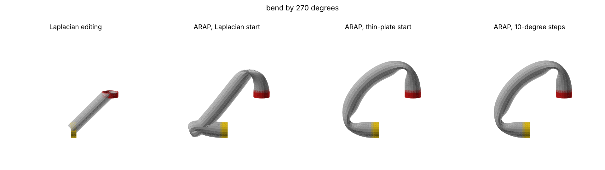
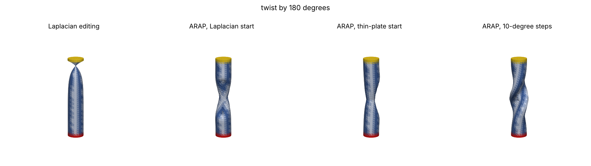
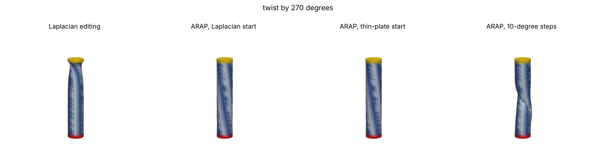
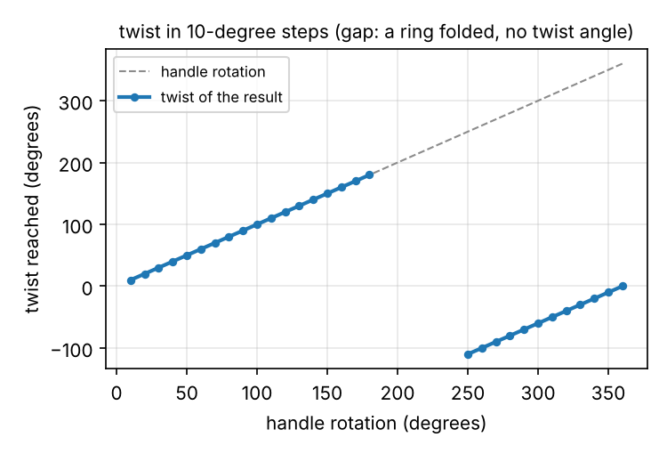
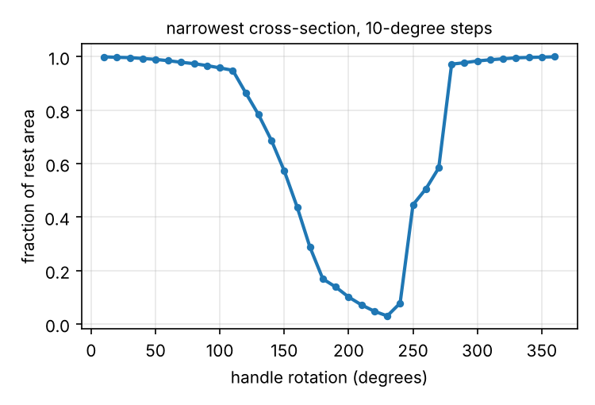
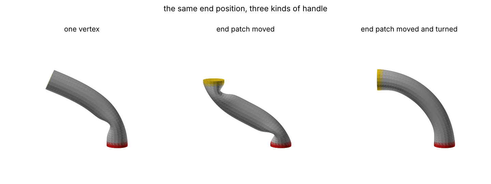

# As-rigid-as-possible surface deformation

COMP 4900D project 2.11: an implementation of "As-Rigid-As-Possible Surface
Modeling" (Sorkine and Alexa, SGP 2007) built on the course's GeomProc
library.


## Setup

Python 3.10 or newer.

```bash
python -m venv .venv
source .venv/bin/activate
pip install -r requirements.txt        # numpy, scipy, matplotlib
pip install -r requirements-dev.txt    # adds pytest, and libigl for the comparisons in the tests and experiments
```

GeomProc is not on PyPI, so version 1.9 (commit `894415c` of
<https://github.com/ovankaic/GeomProc>) is included unchanged in `geomproc/`
together with its licence. Its sample meshes are in `meshes/`. Run every
command from the repository root.

## Usage

```python
import numpy as np
from arap.meshio import load_mesh, save_mesh
from arap import selection as sel
from arap.solver import ARAPDeformer

V, F = load_mesh("meshes/bunny.obj")                  # GeomProc load + normalize
fixed = sel.by_coordinate(V, "y", below=0.15)          # base stays put
ears = sel.by_coordinate(V, "y", above=0.8)            # handle
constrained, targets = sel.combine(V, fixed, ears, V[ears] + [-0.45, -0.15, 0.0])

deformer = ARAPDeformer(V, F, constrained)             # factorises L once
result = deformer.deform(targets)                      # Laplacian guess, then iterate
print(result.iterations, result.converged, result.energies[-1])
save_mesh("output/bunny_arap.obj", result.vertices, F)
```

`ARAPDeformer` can be reused for any number of target positions as long as the
set of constrained vertices stays the same. Options:

| argument | values | default |
|---|---|---|
| `weights` | `"cotangent"`, `"uniform"` | `"cotangent"` |
| `clamp` (negative cotangent weights) | `"zero"`, `"none"` (paper), `"geomproc"` | `"zero"` |
| `init` in `deform` | `"laplacian"` (slides), `"thin_plate"`, `"rest"`, or an (n, 3) array | `"laplacian"` |
| `max_iterations`, `energy_tol`, `step_tol` | stopping rule, see below | 500, `1e-6`, `1e-5` (the experiments allow 1000 iterations) |

Experiments and tests:

```bash
python -m experiments.run_all                      # all experiments, writes output/
python -m experiments.run_all --only bar_bend hinge
python -m experiments.run_all --update-docs        # full run only; also refreshes docs/figures and docs/results.md
python -m pytest
```

`output/` receives, for every scenario, the rest pose, the Laplacian editing
result and the ARAP result as OBJ files with the constrained vertices coloured
(fixed red, handles yellow) for viewing in MeshLab, plus the figures, the
energy curve, `metrics.json` and `summary.md`. A full run takes about 25
minutes, most of it in the large rotations, the long twist and the stability
check.

## Code layout

| module | contents |
|---|---|
| `arap/laplacian.py` | sparse cotangent and uniform weights, `L = D - W`, mixed (Voronoi) areas |
| `arap/rotations.py` | batched best-fit rotations with the reflection fix |
| `arap/linear.py` | constrained sparse solver (factorised once), membrane and thin-plate deformation from the slides |
| `arap/solver.py` | `ARAPDeformer`: local step, global step, energy, gradient, iteration |
| `arap/reference.py` | dense solves with GeomProc's own `geometric_laplacian`, the way the class demos solve systems |
| `arap/selection.py` | choosing fixed and handle vertices, rigid targets (uses GeomProc's rotation helpers) |
| `arap/metrics.py` | edge-length distortion, surface area, enclosed volume, self-intersections |
| `arap/meshio.py` | loading, normalising and saving through GeomProc |
| `arap/viz.py` | off-screen figures with matplotlib |
| `experiments/` | the scenarios and `run_all.py` |
| `tests/` | unit tests, GeomProc consistency checks, comparison with libigl |

## Method

With rest positions `p`, deformed positions `p'`, edge weights `w_ij` and one
rotation `R_i` per vertex, ARAP minimises (paper Eq. 7, with `w_i = 1`)

```
E(p', R) = sum_i sum_{j in N(i)} w_ij || (p'_i - p'_j) - R_i (p_i - p_j) ||^2
```

by alternating two steps, each of which can only lower the energy:

1. **Local step** (Section 2.1). With `p'` fixed, `R_i` is the rotation that
   best maps the rest edges around vertex `i` onto the deformed ones. With
   `S_i = sum_j w_ij e_ij e'_ij^T = U Σ V^T`, `R_i = V U^T`. If that has
   determinant -1, the column of `U` for the smallest singular value is
   negated. All vertices are done in one batched `numpy.linalg.svd` call.
2. **Global step** (Eq. 8 and 9). With the rotations fixed, `p'` solves
   `L p' = b`, where `L = D - W` and
   `b_i = sum_j (w_ij / 2) (R_i + R_j) (p_i - p_j)`.
   Constrained vertices are eliminated (Eq. 10): their columns move to the
   right-hand side and the remaining block stays symmetric positive definite.
   That block depends only on the rest mesh and the constrained set, so it is
   factored once with `scipy.sparse.linalg.splu`. A Cholesky factorisation
   would suit a symmetric positive definite matrix better, but SciPy has no
   sparse Cholesky, so the LU factorisation is run with a symmetric ordering
   and no pivoting, which keeps it close to one. Each iteration then costs
   one batched SVD and three back-substitutions.

**Initial guess.** The course slides (Topic 7) define Laplacian deformation as
solving `Δd = 0` for the displacements `d` of the free vertices, with the
handles and fixed vertices prescribed. With the cotangent operator
`Δ = -M^{-1} L` the per-vertex area factor cancels, so this is `L p' = L p`:
naive Laplacian editing, which is also the global step with every `R_i = I`.
This is the default initial guess, the same one used in the paper's Fig. 3.
The thin-plate version from the slides, `Δ²d = 0` (solved as
`L M^{-1} L d = 0`), is available as an alternative.

**Stopping rule.** Iterate until the energy decrease of an iteration is below
`1e-6` times the energy of the initial guess and no vertex moved more than
`1e-5` of the bounding-box diagonal, or the iteration limit is reached. The
decrease is compared with the initial energy, not the current one: when the
constraints allow a rigid motion the minimum energy is zero, and a decrease
relative to the current energy then never becomes small. Like any rule of this
kind it cannot tell a minimum from a balanced state that is not one (a
saddle), which matters for the twisted bar below.

## Design decisions

**What comes from GeomProc and what is written here.** GeomProc provides
mesh loading, normalisation and saving (`arap/meshio.py`), the rotation
matrices used to build handle targets (`arap/selection.py`), the cylinder
primitive behind every bar mesh, the sample meshes, and the dense
`geometric_laplacian` that the sparse operator is checked against
(`arap/reference.py`). Everything else is written for this project: the
cotangent and uniform weights, the mixed areas and the sparse Laplacian, the
constrained solver, the rotation fitting, the ARAP iteration, the membrane
and thin-plate initial guesses, the metrics and the experiments. GeomProc
has no deformation code to reuse; the class demos' row-replaced dense solves
are reproduced in `arap/reference.py` only for comparison.

**Sparse operator instead of GeomProc's dense one.** GeomProc's
`mesh.geometric_laplacian` builds a dense `n × n` matrix in Python loops, and
the class demos solve with `numpy.linalg.solve` on every call. That is fine for
the bunny but too slow to run hundreds of iterations on the 8 000 to 10 000
vertex meshes (see the timing table). The operator here is built with numpy and
`scipy.sparse`, which the handout allows for linear algebra. With
`clamp="geomproc"` it reproduces GeomProc's operator to rounding error, and
`tests/test_reference.py` checks that the sparse solver and a dense solve on
GeomProc's own matrix give the same deformation.

**A consistent Laplacian.** GeomProc's operator is row-normalised:
`L_gp = D^{-1} W - I`. The handout warns that the Laplacian must be used
consistently. Scaling a row of `L` changes the solution unless the same row of
`b` is scaled by the same factor. With `L_gp` the right-hand side must be
`b_i = sum_j L_gp[i, j] · 1/2 (R_i + R_j)(p_j - p_i)`, and likewise for an
area-weighted operator `M^{-1}(W - D)`. After a single step, pairing `L_gp`
with the paper's unscaled `b` moves vertices by 34 % (bar) to 68 % (bunny) of
the bounding-box diagonal, and pairing the area-weighted operator with it
moves them by 11 % to 24 % (consistency table below; the area-weighted error
also depends on the mesh's scale, since `M^{-1}` scales as one over length
squared). The code uses the unscaled symmetric `L` with the unscaled `b`, and
the tests and the experiments check that both scaled variants give the same
answer when their `b` is scaled to match.

**Negative cotangent weights are clamped to zero.** This is the one deviation
from the paper. The scanned meshes have many obtuse triangles (12 % of the
camel's edges have a negative weight). With negative weights the energy can
become negative and the rest pose is no longer a minimum, so the iterations
walk away from it even when no handle has moved: after 50 iterations the
camel has drifted by 15 % of its diagonal (table below). Clamping makes the energy non-negative and the rest
pose an exact fixed point. GeomProc's operator is also non-negative, because
its mixed-area treatment replaces a negative cotangent by half the triangle
area. The raw weights are still available with `clamp="none"`, which is what
libigl uses, and the tests compare that setting against libigl.

**Elimination instead of row replacement.** The class demos impose
constraints by replacing rows of the matrix with identity rows. That gives the
same solution, but the matrix stops being symmetric. Elimination keeps the
system symmetric positive definite.

## Results

All numbers come from one run of `python -m experiments.run_all` (about 25
minutes) on a shared 4-core 2.1 GHz Xeon virtual machine with Python 3.13,
NumPy 2.5 and SciPy 1.18. On that machine timings can differ by more than
50 % between runs of the same code; every other number is the same from run
to run.
The full tables are in [docs/results.md](docs/results.md). Edge error is the
RMS of the relative edge-length change `(|e'| - |e|) / |e|` over all edges;
distances are divided by the bounding-box diagonal. The loaded meshes are
normalised with GeomProc so their longest side spans [-1, 1]; the synthetic
bar (GeomProc's `create_cylinder`) has radius 0.1 and length 1. The Timing
table gives medians of repeated runs. "ms per iteration" in the Deformations
table is the mean over the iterations of a single run and includes the energy
and the convergence test, and the camel's run time is also from one run.

### Deformations

| scenario | vertices | constrained | iterations | within 1 % of final energy after | edge error, Laplacian editing | edge error, ARAP | largest move after iteration 100 | ms per iteration |
|---|---|---|---|---|---|---|---|---|
| bar bend, 90° | 822 | 82 | 128 | 31 | 0.191 | 0.065 | 0.05 % | 3.2 |
| bar twist, 135° | 822 | 82 | 440 | 131 | 0.174 | 0.067 | 2.9 % | 3.3 |
| two-part cylinder hinge, 60° | 6 002 | 1 202 | 132 | 108 | 0.669 | 0.011 | 0.06 % | 23 |
| bunny ears | 2 503 | 881 | 155 | 22 | 0.068 | 0.036 | 0.13 % | 9.9 |
| kid raising its arms | 8 441 | 724 | 862 | 90 | 0.201 | 0.041 | 4.2 % | 37 |
| camel lowering its head | 9 770 | 3 381 | 797 | 96 | 0.100 | 0.017 | 2.0 % | 41 |

ARAP also keeps the size of the shape much better, except for the bunny's
area, which changes slightly more than with Laplacian editing. Change of
surface area and enclosed volume (the bunny is an open mesh, so it encloses no
volume):

| scenario | area, Laplacian editing | area, ARAP | volume, Laplacian editing | volume, ARAP |
|---|---|---|---|---|
| bar bend | −18.5 % | −0.4 % | −33.8 % | −2.6 % |
| bar twist | −7.4 % | −1.0 % | −16.9 % | −11.5 % |
| hinge | −4.7 % | −0.0 % | −16.0 % | −0.1 % |
| bunny ears | +1.7 % | +2.0 % | - | - |
| kid | +20.4 % | +3.0 % | +27.2 % | −4.0 % |
| camel | −4.0 % | −0.3 % | −2.5 % | −0.6 % |

ARAP has no volume term. The losses that remain (2.6 % for the bar bend,
11.5 % for the twist) most likely come from the cross-sections shrinking: a
bent bar's cross-section flattens a little in the bending plane, which eases
both the compression of the inner side and the stretch of the outer side, and
a twisted tube whose ends are held at the same height flattens into an oval in
the middle (in the stepped twist below, the narrowest cross-section keeps 78 %
of its area at 130° and 69 % at 140°). The twist keeps less of its volume
than the bend but still more than Laplacian editing, which loses 17 %.

**Why the twisted bar is jittered.** The regular bar, its constraints and the
Laplacian-editing start are all symmetric under turning by one side (18°),
and every iteration keeps that symmetry, so the solver can only produce evenly
twisted shapes. Past about 107° an even twist is no longer a minimum: a
flattened cross-section has lower energy. With nothing to push it off, the
solver stays on the even twist until the stopping rule fires; at 135° it
accepted a shape with edge error 0.076 and volume change −6.1 % whose energy
drops by 3.6 % once a small nudge lets it leave (stability check below). The twist scenario
therefore moves the side vertices along the surface by up to 2 % of their
spacing. That is invisible, but it breaks the symmetry, and the solver then
reaches the minimum. It needs more iterations to get there (440), and the
shape still changes by up to 2.9 % of the diagonal after iteration 100 as the
cross-section flattens.

Fixed vertices are red and handles yellow (the twisted bar's other vertices
are striped so the twist shows). Each row shows the rest pose, Laplacian
editing (the initial guess) and the converged ARAP result.


- **Laplacian editing does not rotate local detail.** It only interpolates
  the handle displacements. The bent bar shears into a slanted tube, the
  twisted bar collapses towards its axis near the handle, the kid's arms
  stretch into thin strands, and the camel's body sinks while its legs bend.
  ARAP lowers the edge error by a factor of about 2 (bunny) to 60 (hinge).
- **Rigid parts stay rigid.** In the hinge, the top block should turn as a
  rigid body around the thin neck. Inside the block, leaving out the handle
  itself, the edge error is 0.33 for Laplacian editing and 0.0002 for ARAP.
- **Some stretch is unavoidable.** If a bar of radius 0.1 is bent into a
  quarter circle of radius 2/π ≈ 0.64 and its cross-section stays round, the
  outside of the bend stretches by about 16 % and the inside compresses by as
  much. Flattening the cross-section reduces that but cannot remove it, so no
  deformation that meets these constraints can have zero edge error.


**Convergence.** The energy decreased at every iteration in every run, as the
two exact steps guarantee. Most of the change happens early: the energy is
within 1 % of its final value after 22 to 131 iterations. The shape does not
always settle as fast as the energy. After iteration 100 the bar bend, the
hinge and the bunny move by at most 0.13 % of the diagonal, but the camel
still moves by 2.0 %, the twisted bar by 2.9 % and the kid by 4.2 % (its arms
keep swinging slowly). The stopping rule keeps iterating while vertices creep
by more than `1e-5` of the diagonal, which takes 128 to 862 iterations in all.

**Why this is far more than the paper's 2 to 3 iterations.** The paper's
figure is for interactive editing at 10 to 30 frames per second: the handle
moves a little between frames, each frame starts from the previous frame's
result (the paper's default initial guess), and a few iterations per frame are
enough to keep up while the user drags. Here each scenario is one large edit
solved from scratch, starting from Laplacian editing, which is far from the
answer for bends and twists, and the run continues until the strict stopping
rule holds rather than until the shape looks right. The "within 1 %" column is
the closer comparison. The paper also notes that finer meshes need more
iterations, because the Laplacian's condition number grows with the mesh size;
the triangulation experiment below shows the same.

### Timing

| vertices | setup (weights + factorisation) | local step | global step (sparse) | global step (dense, GeomProc operator) | building GeomProc's operator |
|---|---|---|---|---|---|
| 822 | 4 ms | 2.5 ms | 0.4 ms | 11 ms | 0.30 s |
| 2 594 | 9 ms | 7.6 ms | 1.1 ms | 151 ms | 0.98 s |
| 5 810 | 19 ms | 17 ms | 2.6 ms | 1 098 ms | 2.3 s |
| 23 138 | 92 ms | 67 ms | 11 ms | not run | not run |


Times are for the bar bend on cylinders of increasing resolution. Each
iteration is dominated by the local step (the covariances and the batched
SVD). Because the factorisation is reused, the global step is six to seven
times cheaper than the local step, and hundreds of times cheaper than a dense
`numpy.linalg.solve` on GeomProc's matrix (about 400 times at 5 810 vertices,
with NumPy's dense solve using all four cores). A full ARAP run on the
10 000-vertex camel takes about 32 seconds, most of it in the final creeping
iterations.

### Negative cotangent weights

| mesh | edges with a negative raw weight | drift after 50 iterations, raw weights | same with libigl | drift, clamped at zero |
|---|---|---|---|---|
| bunny | 7.2 % | 0.072 | 0.072 | 4e-14 |
| camel | 11.9 % | 0.148 | 0.148 | 1e-13 |
| kid | 5.2 % | 0.028 | 0.028 | 1e-13 |

No handle is moved in this test, so the rest pose is the correct answer. With
raw weights the energy becomes negative and the surface drifts away from it.
libigl, which uses raw weights, drifts by the same amount.


### Edge weights

| scenario | weights | edge error (RMS) | edge error (max) | iterations |
|---|---|---|---|---|
| bunny ears | cotangent | 0.036 | 0.25 | 155 |
| bunny ears | uniform | 0.037 | 0.31 | 123 |
| bunny ears | cotangent, raw (no clamp) | 0.072 | 1.5 | 165 |
| camel | cotangent | 0.017 | 0.20 | 797 |
| camel | uniform | 0.014 | 0.22 | 1 000 (limit) |
| camel | cotangent, raw (no clamp) | 0.31 | 11 | 1 000 (limit) |

The two clamped weightings give similar edge errors on these meshes.
Cotangent weights have the smaller worst-case error and converge on the
camel, where uniform weights hit the iteration limit. The paper's argument
for cotangent weights is that they make the result depend less on how the
surface is triangulated, which edge error alone does not measure; the
triangulation experiment below tests that directly. The cotangent rows for
the scanned meshes depend on the clamp: with the raw weights the energy goes
negative and the result is much worse, twice the edge error on the bunny and
eighteen times on the camel.

### Initial guess

| scenario | Laplacian editing (slides) | thin plate (slides) | rest pose |
|---|---|---|---|
| bar bend | 128 iterations | 118 | 142 |
| hinge | 132 | 93 | 227 |
| camel | 797 | 781 | 798 |


All three starting points reach the same pose to within 0.1 % of the
diagonal. The thin-plate guess starts at a lower energy and saves iterations
on the bar and the hinge. Starting from the rest pose costs the most
iterations.

### Agreement with GeomProc and libigl

Largest distance between corresponding vertices, divided by the bounding-box
diagonal.

| | bar bend | bunny ears |
|---|---|---|
| membrane solve, GeomProc operator | 7e-15 | 1e-15 |
| one ARAP step, GeomProc operator, consistent `b` | 7e-15 | 2e-15 |
| ten ARAP iterations, GeomProc operator | 2e-14 | 6e-15 |
| one step, GeomProc operator, inconsistent `b` | **0.34** | **0.68** |
| one step, area-weighted operator, consistent `b` | 2e-12 | 5e-13 |
| one step, area-weighted operator, inconsistent `b` | **0.11** | **0.24** |
| libigl, ten iterations, raw weights | 9e-6 | 6e-5 |

The GeomProc rows compare the sparse solver (with `clamp="geomproc"`)
against dense solves on GeomProc's own `geometric_laplacian` with rows
replaced for the constraints, as in the class demos. The area-weighted rows
use `M^{-1}(W - D)` with the mixed areas. "Inconsistent" pairs a row-scaled
matrix with the paper's unscaled right-hand side, which is the mistake the
handout warns about. The last row compares the raw-weight setting with
libigl's ARAP (spokes energy, the paper's energy) on these two meshes only.
libigl fits the rotations in single precision, which most likely explains the
remaining difference.

### Large rotations

The default scenarios bend the bar by 90° and twist it by 135°. Here the
bends go to 270° and the twists to 360°. Bends use a thinner bar (radius
0.05, 61 rings): bending the default bar by 270° would compress its inner side
by about half. Twists use the default, slightly jittered twist bar. Each edit
is solved three ways: from the Laplacian-editing guess (the default), from the
thin-plate guess, and in 10° steps where each solve starts from the previous
result, as in the paper's interactive use. These solves use a tighter
stopping rule than the default (`energy_tol=1e-8`, `step_tol=1e-6`, up to
10 000 iterations), because close to where the even twist stops being a
minimum the energy is almost flat and the default rule stops early. Final
energies, with the full table in [docs/results.md](docs/results.md):

| | Laplacian start | thin-plate start | 10° steps |
|---|---|---|---|
| bend 90° | 0.0022 | 0.0022 | 0.0022 |
| bend 180° | 0.0081 | 0.0081 | 0.0081 |
| bend 270° | 0.050, passes through itself | 0.015 | 0.015, the same loop |
| twist 90° | 0.016 | 0.016 | 0.016 |
| twist 180° | 0.030, folded through itself | 0.030 (iteration limit), the same | 0.052, twisted, flattened in the middle |
| twist 270° | 0.016, a 90° twist the other way | 0.016, the same | 0.025, a −90° twist with a fold left in it |
| twist 360° | 0, the rest pose | 0, the rest pose | 1e-9, the rest pose |



- **Bends: the thin-plate start and the steps fix the failure.** Up to 180°
  all three starts reach the same shape. At 270° Laplacian editing shortens
  and shears the bar into a straight tube between its ends. ARAP started
  there ends with three times the energy and the bar passing through itself
  (215 crossing edge-triangle pairs): parts of the surface are turned inside
  out, so the signed volume even changes sign (a volume change of −108 %).
  This is a genuine local minimum, not an early stop or a balanced unstable
  state: continued with a tight rule, with or without a nudge, it stays at
  the same energy (stability check below).
  The thin-plate start (after 8 405 iterations) and the steps both reach the
  same loop, with energy 0.0149 and no crossings. The loop is not round: its
  cross-section flattens and it creases near both ends, and it loses 14 % of
  its volume.
- **Twists: the handle positions do not say how many turns were made.** After
  a 270° turn the handle vertices sit exactly where a −90° turn puts them,
  and after 360° exactly where they started. A single solve therefore returns
  a 90° twist the other way for 270°, and the untwisted bar for 360°, from
  either start.
- **On this bar, a twist past about 110° flattens the tube.** Up to 110° the
  stepped twist is even and every cross-section keeps at least 95 % of its
  area. From 120° on, the cross-section in the middle flattens into an oval
  and narrows step by step, to 87 % of its rest area at 120°, 57 % at 150°
  and 17 % at 180°, while the energy rises steadily (0.024 at 110°, 0.040 at
  150°, 0.052 at 180°). At 180° the walls in the middle start to pass through
  each other (40 crossing pairs). From 190° to 240° rings in the middle fold
  over themselves, so the twist is undefined (the gap in the plot), and the
  narrowest cross-section falls to 3 % to 14 %. At 250° the fold opens partly
  and the energy drops from 0.065 to 0.028: the twist now reads −110°, but
  the walls still cross. At 280° the bar is an even −80° twist with the same
  energy as the +80° step, which then unwinds evenly to the rest pose at
  360°.
- **A single solve at 180° folds the tube instead.** From either guess the
  180° twist buckles and folds through itself into a shape with energy 0.030,
  far below the stepped, still twisted shape's 0.052, which is a separate
  local minimum (it passes the stability check below). ARAP has no explicit bending
  term and no volume term, so a hollow tube can lower its energy by
  flattening, folding or buckling instead of twisting evenly. These solves
  are slow: 9 509 iterations from the Laplacian guess, and the thin-plate
  start was still creeping at the 10 000-iteration limit.
- **The limit depends on the bar's proportions.** On a bar three times as
  long, with the same radius, ring spacing, jitter and end slabs (2 422
  vertices), the 10° steps reach a real 270° twist: no walls cross, every
  cross-section keeps at least 97 % of its area, and the energy rises smoothly
  to 0.046 (second step table in [docs/results.md](docs/results.md)). That is
  90° of twist per unit length, as in the default bar's 90° twist, which is
  just as clean. So the steps do hold a twist past 180°; what the default
  bar cannot take is more than about 110° of twist over its length.






"Narrowest" is the area that a ring of side vertices winds around when it is
projected along the bar's axis, as a share of its rest area. Once rings tilt,
this projected area is smaller than a cut straight across the bar, so it
exaggerates the narrowing of strongly deformed rings. "Folded" means the
vertices of a ring turned by angles so different that the length of their
mean direction is below 0.5; it is a threshold on how well they agree, not a
test for folded triangles. The volume changes in
[docs/results.md](docs/results.md) are changes of the signed volume, so where
the walls cross they are not the volume of any real solid. With that caveat:
the bends that work lose 0.3 % (90°), 3.5 % (180°) and 14 % (270°) of their
volume, the 180° twists 16 % to 23 %, against 2.7 % for the 90° twist (and
3.2 % for the single 270° solves, which are 90° twists). The steps are not
cheap with this stopping rule either: each 10° step takes about 120 to 130
iterations on average for the bends up to 180° and the 90° twist, and the
stepped 270° bend takes about 12 700 in total.

### One handle vertex instead of a patch

The paper's dinosaur (Fig. 1) and cactus (Fig. 7) are edited by moving a
single vertex. Here the end of the default bar is moved to the end of the 90°
arc in three ways:

| handle | handle vertices | energy | edge error | end rotation | volume change |
|---|---|---|---|---|---|
| centre vertex of the top cap, moved | 1 | 0.011 | 0.048 | 65° | −5.2 % |
| top end, moved | 41 | 0.031 | 0.072 | 0° | −10.9 % |
| top end, moved and turned by 90° (the bar bend scenario) | 41 | 0.016 | 0.065 | 90° | −2.6 % |



A single vertex has no orientation, so ARAP decides how the end turns. It
turns by 65° on its own: ARAP produces rotations from a translation alone,
which is the point of the paper's cactus example and something Laplacian
editing cannot do. Because the end's orientation is free, this has the lowest
energy of the three. No spike forms at the moved vertex; its neighbours follow
it, and most of the bending gathers in a kink near the fixed end. A moved
patch keeps its orientation, so the bar has to bend back to meet it in an
S shape, with nearly three times the energy of the single vertex (and twice
that of the turned patch).

### Triangulation and resolution

The 90° bar bend is repeated on eleven meshes of the same bar, named
sides × rings: coarser and finer regular meshes, long thin triangles
(16 × 81), the 20 × 41 mesh with every quad diagonal flipped the other way,
and the 20 × 41 mesh with every side vertex between the end rings moved
randomly along the surface by up to 20 % of the spacing ("irregular"; up to
25 % no triangle can fold over). Only the end caps are constrained, so the
constraints mean the same thing on every mesh. Results are compared at 800
fixed points of the bar's side, found by their barycentric coordinates in the
rest mesh; distances are shares of the bounding-box diagonal. Before any
deformation these points already differ by up to 0.18 % between meshes,
because each side is a polygon with its own number of sides.

**Does the result depend on the triangles?** The bend is symmetric about the
plane x = 0, and so is a regular bar as a set of points, but its triangles are
not: every quad has its diagonal the same way round, and the mirror image of
the mesh has every diagonal flipped. A result that does not depend on the
triangulation must therefore be its own mirror image, and must not change
when the diagonals are flipped.

| 90° bend | cotangent | uniform |
|---|---|---|
| 20 × 41: result against its mirror image, vertex by vertex (max) | 0.00 % | 1.53 % |
| 20 × 41: how far flipping every diagonal moves the result (RMS / max) | 0.00 % / 0.00 % | 0.99 % / 1.53 % |
| 20 × 41 irregular: result against its mirror image (RMS) | 0.18 % | 1.0 % |

- **Cotangent weights make the result far less dependent on the
  triangulation, as the paper says.** Uniform weights treat a diagonal like
  any other edge, so the result leans towards the diagonals: flipping them
  moves it by up to 1.5 % of the diagonal, and it is up to 1.5 % away from its
  own mirror image. On the regular meshes the cotangent weight of every
  diagonal is exactly zero (it is opposite two right angles), so there the
  cotangent result cannot depend on the diagonals at all; that part of the
  test holds by construction. The irregular mesh is the stronger test,
  because its cotangent weights do depend on the triangles, and its vertices
  are placed at random, so no result on it can be exactly symmetric: the
  cotangent result is 0.18 % (RMS) from its mirror image, the uniform result
  1.0 %. Jittering also gives some edges a negative cotangent weight, which
  the default clamp sets to zero. Measured against the 20 × 41 result with
  the same weights, as in the table in [docs/results.md](docs/results.md),
  the two weightings look about equally insensitive on the meshes that keep
  the even arc (0.1 % to 0.4 % for cotangent, 0.1 % to 0.6 % for uniform),
  because every uniform result on a regular mesh leans the same way as the
  uniform reference.
- **On finer meshes the bar kinks instead of bending evenly.** The kink
  measure in [docs/results.md](docs/results.md) is the sharpest turn of the
  bar's centre line from one ring to the next, divided by its mean turn (1 for
  an even arc). With cotangent weights the bend stays an even arc (1.0 to 1.6)
  on 12 × 25, 20 × 41, 16 × 81 and 12 × 81, and creases near the ends (2.5 to
  7.6) on 32 × 41, 20 × 81, 12 × 161, 32 × 81 and 48 × 77. Whether it kinks
  depends on the spacing along the bar as much as on the number of sides:
  20 sides kink with 81 rings but not with 41, 12 sides with 161 rings but
  not with 81. The kinked shapes have lower energy than the even arc, and the
  energy keeps falling as the mesh gets finer (0.0148 at 20 × 41, 0.0139 at
  20 × 81, 0.0134 at 32 × 41, 0.0113 at 32 × 81, 0.00925 at 48 × 77). Uniform
  weights keep the arc on 20 × 81, 12 × 161 and 32 × 81, dent on 32 × 41 and
  kink on 48 × 77. We read this as a property of the energy, not a numerical
  error: in the stability check below the kinked 32 × 81 result, nudged or
  not, converges to the same kinked shape with an energy 0.07 % below where
  the 1 000-iteration limit stopped it, so it is a minimum the solver was
  still approaching, not a balanced state that a nudge tips over. ARAP has
  no explicit
  bending term: it penalises each vertex neighbourhood for any change other
  than a rotation, and a neighbourhood that only bends with the surface costs
  a little, but that cost falls as the triangles get smaller. The inner side
  of an even bend with a round cross-section has to compress by about 16 %;
  creasing avoids much of that compression at the price of sharp bending,
  which a finer mesh pays less for. Coarse meshes are too stiff to crease, so
  they give the even arc. On the meshes tested (up to 48 sides and 161 rings)
  the ARAP result for this thin hollow bar depends on the resolution, and
  refining the mesh does not settle on one answer.
- **Iterations grow with resolution**, as the paper says: on the regular
  meshes that keep the even arc, cotangent weights need 62, 124 and 251
  iterations at 302, 822 and 1 298 vertices. The four finest kinked meshes
  reach the 1 000-iteration limit while still creeping. Cotangent energies can
  be compared between the regular meshes; on the irregular mesh the clamped
  weights change the energy. With uniform weights the energy also depends on
  the shape of the triangles (0.0075 on the long thin triangles against 0.019
  on 20 × 41).

### Is each result a minimum?

The stopping rule only says that the iterations have nearly stopped moving.
A balanced state that is not a minimum (a saddle) passes it as well as a
minimum does, and a perfectly symmetric start can stay on such a state,
because each iteration keeps the symmetry. The `stability` experiment
therefore continues key results in two ways with a much tighter rule
(`energy_tol=1e-10`, `step_tol=1e-8`, up to 5 000 iterations): as they are,
and after every free vertex has been moved at random by up to 0.1 % of the
diagonal. From a minimum both runs end at the same energy and shape. From a
saddle the nudged run ends lower.

| result | energy | continued | nudged | nudged against continued | the two shapes are apart by |
|---|---|---|---|---|---|
| bar twist 100°, regular bar | 0.019603 | 0.019603 | 0.019603 | +0.000 % | 0.00 % |
| bar twist 105°, regular bar | 0.021564 | 0.021564 | 0.021564 | +0.000 % | 0.00 % |
| bar twist 110°, regular bar | 0.023611 | 0.023611 | 0.023592 | **−0.081 %** | **1.14 %** |
| bar twist 135°, regular bar | 0.035097 | 0.035097 | 0.033830 | **−3.610 %** | **4.01 %** |
| bar twist 135°, jittered bar (the scenario) | 0.034175 | 0.034173 | 0.034173 | −0.000 % | 0.00 % |
| bar bend 90° | 0.015611 | 0.015611 | 0.015611 | +0.000 % | 0.00 % |
| bend 270°, Laplacian start (passes through itself) | 0.049544 | 0.049544 | 0.049544 | −0.000 % | 0.00 % |
| bend 270°, 10° steps | 0.014873 | 0.014873 | 0.014873 | −0.000 % | 0.00 % |
| twist 180°, 10° steps | 0.051647 | 0.051647 | 0.051647 | −0.000 % | 0.00 % |
| bend 90°, one handle vertex | 0.011314 | 0.011314 | 0.011314 | +0.000 % | 0.00 % |
| bend 90°, 32 × 81, end caps only | 0.011338 | 0.011331 | 0.011331 | −0.000 % | 0.00 % |

On the regular bar the even twist is a minimum at 105° but not at 110°. At
135° the tight rule alone changes nothing: the continued run stays on the even
twist at 0.0351, while the nudged run drops 3.6 % to 0.0338 and ends 4 % of
the diagonal away. So a tighter tolerance would not have caught this; the
symmetry has to be broken, which is why the twist scenario jitters the bar.
Every other result passes: nudged or not, it ends at the same energy and
shape. Two had not finished converging and move on the same way in both runs:
the 32 × 81 bend, which had stopped at the 1 000-iteration limit, and, very
slightly, the jittered 135° twist, which is still creeping at the end of both
5 000-iteration runs (as are the 270° stepped bend and the 180° stepped twist,
with no change in energy at this precision).

### Limitations

- The constraints are hard, and the set of constrained vertices is fixed
  when the solver is created. A new set means a new factorisation, which
  takes about 0.1 s or less here.
- Convergence is linear, so a tight tolerance costs many iterations on large
  meshes. The paper's interactive setting runs only a few iterations per
  frame.
- The energy has no explicit bending term and no volume term, and nothing
  stops the surface from passing through itself. Hollow shapes such as the
  bar can flatten, kink, fold or buckle instead of bending or twisting
  evenly, under large edits and, on fine meshes, under moderate ones.
- Positional constraints do not record how many turns a handle has made: a
  270° twist is solved as a 90° twist the other way, and 360° as no twist.
  Moving the handle in 10° steps keeps count, but on the default bar the
  tube flattens past about 110°, its walls cross from 180° and it folds and
  later unwinds; a bar three times as long keeps a clean 270° twist.
- The stopping rule cannot tell a minimum from a balanced state that is not
  one. A symmetric mesh and start can stay on such a state: the regular bar's
  135° twist did, until the bar was jittered. The stability check above
  catches this, but it is a separate experiment, not part of the solver.
- Clamping negative weights changes the energy on meshes with obtuse
  triangles. An intrinsic Delaunay Laplacian would avoid negative weights
  without changing the energy, but it is beyond the scope of this project.

## Libraries and references

- O. Sorkine and M. Alexa. As-Rigid-As-Possible Surface Modeling. *Symposium
  on Geometry Processing*, 2007.
- M. Meyer, M. Desbrun, P. Schröder and A. H. Barr. Discrete
  Differential-Geometry Operators for Triangulated 2-Manifolds. In
  *Visualization and Mathematics III*, Springer, 2003 (mixed Voronoi areas).
- COMP 4900D course slides, Topic 7: Deformation.
- [GeomProc](https://github.com/ovankaic/GeomProc) 1.9: mesh loading,
  normalisation and saving, rotation helpers, sample meshes, and the reference
  `geometric_laplacian`.
- [NumPy](https://numpy.org/): arrays and the batched SVD.
- [SciPy](https://scipy.org/): sparse matrices and the sparse LU factorisation.
- [Matplotlib](https://matplotlib.org/): figures.
- [libigl](https://libigl.github.io/) Python bindings: an independent ARAP
  implementation used only for comparison, in the tests and in two experiment
  columns (rest-pose drift with raw weights, and the libigl column of the
  agreement table). The `arap/` package does not use it; without it the tests
  that need it are skipped and those columns are left empty.
